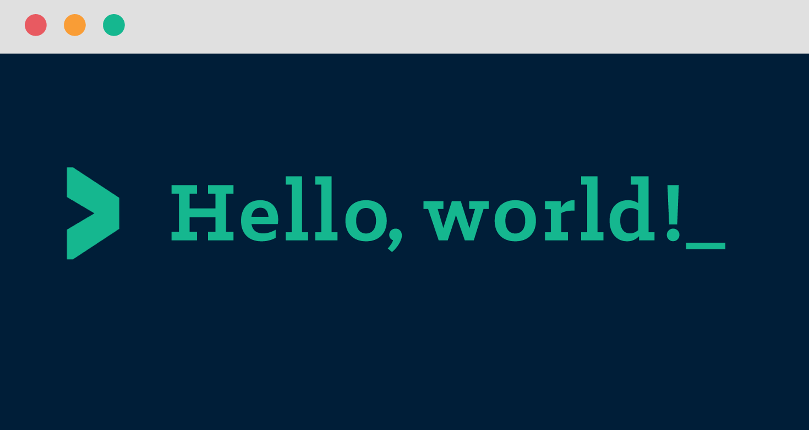

 

 

Hi, my name is Roy. I'm a Full Stack Web Developer (mostly) but I have several side projects on IoT, Desktop and Mobile too.
I like challenges (not when close to the deadline of course) and new technology.
I love open source project ♥ but rarely to contribute because on the other hand I like to take several projects at once 💸

<i><b>Profiles</b></i>

 

Beside of code, I love listening to music

 

    

Hug to all developers in this big digital world

